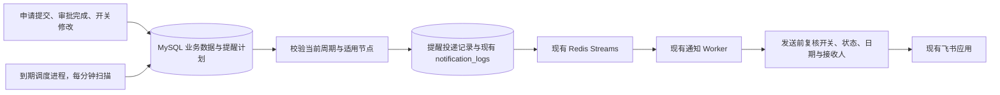

# License 与资源申请飞书到期提醒设计

版本：评审稿 v1.0  
日期：2026-11-04  
定位：可用于需求评审、开发拆分和上线验收；本文列出的新增行为均为设计建议。

## 1. 目标与范围

通过现有平台飞书应用，提前通知责任人办理 License 续期、资源延期或资源回收。支持责任人管理单据是否继续提醒，并保留修改和投递记录。

| 业务 | 提醒节点 | 接收人 | 单据开关修改人 | 生效条件 |
|---|---|---|---|---|
| License | 到期前 1 个自然月、15 天、7 天、1 天 | 申请人、实际完成最终审批的人 | 申请人、实际完成最终审批的人 | 已生成、未删除、尚未到期 |
| 资源申请 | 结束日期前 7 天 | 申请人、该单据的运维执行人员 | 申请人、该单据有权限的运维执行人员 | 运维执行已完成、未删除、使用期限尚未结束 |

一期交付固定节点、共用开关、定时生成通知、现有飞书投递、记录查询、故障补偿和历史数据接入。资源延期审批、自动回收、License 自动续期、已过期后持续催办分别作为后续业务需求评估。

## 2. 已有能力与实现依据

项目采用 Vue 3、FastAPI、MySQL 和 Redis。现有飞书通知链路可直接复用：

- `backend/app/main.py` 的 `notify()` 按接收人创建 `notification_logs`，组合平台名称和单据链接；目前参数使用 FastAPI `BackgroundTasks`。
- `backend/app/notification_queue.py` 以 MySQL 通知记录为持久发件箱，通过 Redis Streams 分发；定期补回遗漏入队的消息。
- `backend/app/notification_worker.py` 独立消费，支持多个实例，当前每 5 秒检查待发送和待重试记录。
- `backend/app/feishu.py` 复用平台应用配置、成员 `open_id`、令牌缓存和稳定的消息 UUID；投递失败目前最多尝试 3 次。
- `LicenseRequest.final_approver_id` 已记录实际促成最终审批完成的人；会签、或签和 N 人审批均以该字段为准。
- 资源结束日期现为 `ResourceRequest.end_date` 字符串。资源表没有独立的运维责任人字段，应从该单据当前轮次的执行节点和实际处理记录确定责任人。

一期新增“何时产生到期通知”的业务能力，并为此类通知补充发送前有效性校验。飞书应用、人员绑定、发送通道、重试入口和平台链接沿用现有配置。

## 3. 业务规则

### 3.1 时间口径

统一按 `Asia/Shanghai` 计算和展示，后端持久化计算后的 UTC 时间。

**License：** 按真实到期时间向前计算，保留时分秒。1 个月采用自然月，遇到目标月份没有同一日期时取该月最后一天；15 天、7 天、1 天分别向前减对应天数。

例如到期时间为 2026-12-20 18:00，则计划时间为：2026-11-20 18:00、2026-12-05 18:00、2026-12-13 18:00、2026-12-19 18:00。2027-03-31 18:00 的 1 个月节点为 2027-02-28 18:00。

**资源：** `end_date` 表示包含当天的最后使用日，提醒时间为该日期前 7 天的北京时间 09:00。例如结束日期为 2026-12-20，计划于 2026-12-13 09:00 提醒，文案为“将于 2026-12-20 结束”。使用期结束的技术边界为次日 00:00，采用半开区间，避免 23:59:59 的精度问题。

每个节点对每位接收人最多建立一条有效通知。实际投递使用现有重试机制，不能把每次定时扫描视为一次新的提醒。

### 3.2 接收人和责任人

**License：** 接收人是申请人和 `final_approver_id`。最终节点存在多人时，只取实际触发审批完成的最后审批人；转交后取实际操作人。通知不包含 License Key。

**资源：** 执行节点进行中，以当前有效运维待办的受理人作为有权修改开关的运维人员；执行完成后，以当前成功流程轮次、最终执行节点中实际完成任务的运维人员作为提醒接收人及开关修改人。

会签或 N 人执行产生多个实际执行人时均纳入，或签中被自动关闭的其他待办人员不纳入。执行前发生转交，以转交后的实际执行人为准。旧轮次的驳回记录、普通审批人和无关运维人员不纳入。

同一个人具有多个身份时，按用户 ID 去重。同一单据的一位收件人配置异常，不影响其他有效收件人。

历史记录无法可靠识别运维执行人时，继续为申请人安排提醒，将运维接收人缺失列入上线异常清单，由运维负责人核对补录；补录须具有指定权限并记录审计，不按所有运维账号推断责任人。

### 3.3 开关与权限

一期采用**每张单据一个共用开关，默认开启**。关闭影响该单据所有接收人的后续到期提醒。

| 操作 | 申请人 | License 最后审批人 | 本资源单有效运维执行人 | 其他人员 |
|---|---|---|---|---|
| 创建时设置是否提醒 | 可以 | — | — | — |
| 修改本人申请的开关 | 可以 | — | — | — |
| 修改对应 License 开关 | 可以 | 最终审批完成后可以 | — | 仅具有相应业务身份时可以 |
| 修改对应资源开关 | 可以 | — | 有效执行待办期间或完成后可以 | 仅具有相应业务身份时可以 |
| 查看开关及修改记录 | 按单据可见权限 | 按单据可见权限 | 按单据可见权限 | 按单据可见权限 |

系统管理员维护全局飞书配置、通知重试和历史异常数据，但不因管理员或 License 管理者角色自动获得单据开关修改权。

申请人提交或驳回重提时可设置开关；重提默认继承已有开关，不能静默恢复开启。审批中配置可保存，满足业务生效条件后才产生到期通知。

修改采用版本号校验，提交 `expected_revision`。两人同时修改时，后提交的旧版本返回冲突，刷新后重试。没有实际改变的保存不新增业务修改日志。

关闭时将该单据尚未发出的到期通知停止发送，保留原因和历史记录；已成功发送的消息保留。开关修改、业务日志和相关待发记录状态在同一个事务内提交。

发送前仍须重新校验开关。外部飞书请求已经开始时无法保证撤回；关闭接口成功返回后，不再启动新的此类投递请求。实现需统一加锁顺序，保证修改与发送之间的边界可解释。

### 3.4 生效、补发与重新开启

License 在最终审批成功、生成结果提交后生效；资源在执行完成事务提交后生效。资源的流程状态 `completed` 表示已交付使用，仍在使用期内时必须继续提醒。

审批通过、执行完成、重新开启、故障恢复或历史单据接入时，如果已经错过节点：

1. 找到当前周期内计划时间不晚于现在的最近一个节点。
2. 如果该节点对某接收人尚未成功发送，安排这一条；更早的节点记为跳过，保留原因。
3. 继续保留将来的节点。最近节点已成功发送时，不再补更早的节点。
4. 实际已到期的 License、使用期已结束的资源不补发到期前提醒。

例如 License 审批完成时剩余 10 天，立即产生一条补提醒，之后保留 7 天和 1 天节点；文案显示真实到期时间和实际剩余期限。不能连续发送 1 个月与 15 天两条历史提醒，也不能把补发文案写成“还剩 15 天”。

同一周期关闭再开启不增加周期版本，已经发送过的节点不重发；尚未发送且仍适用的节点复用原投递身份及消息 UUID。频繁切换开关不能不断产生新消息。

### 3.5 日期、人员与数据变化

- 到期时间或有效流程轮次变化时，创建新的提醒周期，取消旧周期未发送消息；新周期按上述补发规则计算。开关变化只增加配置修订号，不创建新周期。
- 目前已生成 License 没有直接修改到期时间的业务入口。后续续期功能必须在合法生成新授权后更新提醒周期。
- 资源重提取新流程轮次和新结束日期，旧轮次执行人不得沿用为当前责任人。
- 单据删除后停止生成和投递提醒。项目停用本身不等于授权失效或资源使用结束，不能据此自动取消已有有效单据的提醒。
- 账号停用或失去必要业务资格时，跳过该收件人并记录异常；资源收件人发送前须仍具备运维角色和该单据的有效责任关系。其他有效收件人继续发送。
- 全局飞书通知关闭、凭据或 `open_id` 缺失时，沿用现有“待配置”处理。配置修复后由补偿扫描或管理员重试处理，处理前重新选择当前适用节点，避免过时提醒集中发送。

## 4. 页面与飞书消息

### 4.1 页面

申请表增加“到期提醒 / 结束提醒”，默认开启，说明固定节点、飞书渠道和接收人范围。

详情页增加提醒信息区：开关、提醒规则、接收人姓名、接收人配置异常、下一次计划时间、最近修改人及时间。资源执行人尚未确定时显示“运维执行后确定”；关闭时显示“已关闭”，不展示不存在的下一次计划。

“下次提醒”仅显示未来最近一个规则节点的固定计划时间，与当前节点的排队、补发、重试和未配置状态分开。当前节点按接收人展示投递状态、原计划时间及实际重试时间；没有未来节点显示“无后续提醒节点”，不推断所有消息均已送达。“提醒开关最近修改”只在开关实际变化时更新；读取详情、展开记录和提交相同设置均不修改时间、版本、日志或投递状态。

开关说明明确写出：“关闭后，本单据所有接收人将停止收到后续到期提醒。”有权限者可操作，其他可见人员只读。保存成功后反馈实际状态；并发冲突时提示刷新。

列表增加提醒开关状态和下次计划时间，支持按开启、关闭筛选。详情提供本单据提醒记录；管理员继续在现有通知记录页查看失败原因并重试，普通成员查看范围沿用现有权限。

### 4.2 消息

沿用现有飞书机器人单聊文本、平台名称前缀和单据链接，节点提醒不携带密钥、密码或完整身份标识。

License 示例：

```text
【平台名称】License 到期提醒
申请编号：LIC-2026-0123
项目：客户服务平台
客户 / 产品：某客户 / 某产品
到期时间：2026-12-20 18:00（北京时间）
本次提醒：到期前 7 天
请提前安排续期；无需继续提醒时，可在申请详情关闭。
<现有平台配置生成的 License 详情链接>
```

资源示例：

```text
【平台名称】资源使用结束提醒
申请编号：RES-2026-0456
项目：客户服务平台
资源类型：ECS
申请人：张某
结束日期：2026-12-20（北京时间，含当天）
本次提醒：结束前 7 天
请申请人与运维人员确认是否延期或安排回收。
<现有平台配置生成的资源详情链接>
```

补发消息使用“当前剩余期限”替代固定倒计时描述，并标记“生效后补提醒 / 恢复后补提醒”；跳转详情后按现有权限查看和处理。

## 5. 技术方案



### 5.1 最小数据结构

| 位置 | 建议新增内容 | 用途 |
|---|---|---|
| `license_requests`、`resource_requests` | `reminder_enabled`、`reminder_revision`、`reminder_updated_by`、`reminder_updated_at` | 共用开关、并发控制与最近修改信息 |
| `reminder_plans` | 业务类型、业务 ID、周期版本、有效流程实例 ID、到期时间快照、规则代码、计划时间、计划状态 | 保存每个周期的节点与扫描依据 |
| `resource_reminder_contacts` | 资源 ID、流程实例 ID、用户 ID、来源执行节点、来源任务 ID、必要的补录来源信息 | 固化实际运维责任关系，支持可靠历史补录 |
| `reminder_deliveries` | 计划 ID、接收人 ID、通知 ID、状态、停止或跳过原因 | 按接收人去重，并关联现有通知记录 |
| `notification_logs` | 可空的提醒投递关联；新增停止发送状态及对应筛选展示 | 普通工单通知保持原逻辑，到期提醒可校验和暂停 |

`reminder_plans` 的唯一约束为“业务类型 + 业务 ID + 周期版本 + 规则代码”，`reminder_deliveries` 的唯一约束为“计划 ID + 接收人 ID”。`notification_id` 也需唯一，防止一条通知关联多个投递。

规则代码建议为 `license_1m`、`license_15d`、`license_7d`、`license_1d`、`resource_7d`。相同周期内的重新开启、网络重试和人工重试均复用同一个投递身份。

计划增加“计划状态 + 计划时间 + ID”索引，投递增加待处理状态及通知关联索引。资源原始结束日期在接口校验及迁移时严格解析为日期，非法历史值列异常，扫描使用已经计算好的计划时间，避免对字符串全表反复计算。

### 5.2 调度与事务

新增独立 `python -m app.reminder_scheduler` 入口，与 API 使用同一后端镜像，在 Docker Compose 和 Kubernetes 中单独部署。正常运行每分钟扫描一次，API 多副本不各自启动内存定时器。

初期部署一个调度副本；实现仍使用业务行锁、计划锁和数据库唯一约束，支持进程重启、部署短暂重叠和后续扩容。多个实例抢占同一节点时只允许建立一条对应投递。

写入计划、按接收人创建投递、写入 `notification_logs` 必须明确事务边界。通知记录与投递关联在同一事务提交后，再调用现有队列分发；Redis 入队失败时由现有 Worker 的发件箱扫描补偿。

将当前 `notify()` 中创建通知与组织链接的逻辑抽成可供 API 和调度进程复用的服务函数，由调用方控制提交。调度进程不能直接复用依赖 HTTP 响应执行的 `BackgroundTasks` 作为唯一触发手段。

调度进程也需周期性对齐近期业务变化、历史接入异常与失效计划，覆盖“业务已提交、计划尚未建立”的恢复场景。批次处理设置上限并逐批推进，避免单次事务锁住大量业务。

### 5.3 Worker 与人工重试

对有关联的到期提醒，发送及人工重试前检查：单据存在且未删除、符合生效状态、开关开启、周期和日期快照有效、节点仍是当前应投递节点、接收人身份有效、业务未过期。

过时节点记为跳过，关闭或旧周期消息记为停止；已停止记录不应被队列消费逻辑重新发送。`deliver_notification()` 应显式限制可投递状态，不能只检查“不是 sent 就继续发送”。现有人工重试接口也须调用同一套有效性校验。

统一锁顺序建议为“业务记录 → 计划 / 投递 → 通知记录”，避免开关修改、调度与 Worker 的死锁。涉及外部请求的投递应与关闭操作串行确定边界，先采用项目已有的行锁保护模式，并设置现有网络超时。

继续使用现有飞书稳定 UUID 和最多 3 次自动尝试。数据库去重防止重复建单，飞书 UUID 降低外部重试重复消息的概率；跨网络不能承诺无限期严格只送达一次。

### 5.4 接口与审计

建议新增：

```text
PATCH /api/licenses/{id}/reminder
PATCH /api/resource/{id}/reminder

请求：{ "enabled": false, "expected_revision": 3 }
响应：当前开关、修订号、修改人、修改时间、接收人、下一次计划时间
```

创建与重提接口接受 `reminder_enabled`，不传时遵循创建默认开启、重提继承原值的规则。列表与详情返回 `can_edit_reminder`，后端每次独立判断，不能只依赖前端开关显隐。

沿用现有业务操作日志，为提醒开关、运维接收人补录增加字段标签和审计动作，保存修改前后值、操作人、业务单号及北京时间。开关关闭通常不强制填写原因，以免增加操作负担；历史接收人补录须填写依据。

### 5.5 可观察性

至少记录调度最后成功时间、扫描量、生成量、最老待处理计划延迟、待配置数、自动重试耗尽数、缺失运维责任人数。调度进程提供健康检查，接入现有部署健康监控。

到期提醒与普通审批通知使用不同事件类型，在现有通知页面支持识别业务类型、提醒节点和停止原因；排障能从单号追溯到计划、接收人、投递和飞书结果。

## 6. 交付拆分与估算

以下为评审前的粗估，假设由熟悉项目的 1 名后端、1 名前端负责，测试按阶段参与，采用现有飞书配置与部署方式。

| 工作包 | 主要交付物 | 主责 | 估算人日 | 依赖 |
|---|---|---|---|---|
| 规则定稿 | 时间、身份、开关、补发、历史口径 | 产品 / 项目负责人、运维 | 0.5 | 无 |
| 数据与业务接口 | 可重复执行迁移、开关鉴权、审计、执行人快照 | 后端 | 1.5–2 | 规则定稿 |
| 调度与投递接入 | 计划生成、去重、补偿、Worker 和重试校验 | 后端 | 2–3 | 数据设计 |
| 页面 | 申请表、详情开关、状态、记录展示 | 前端 | 1.5–2 | 接口契约，可并行 |
| 联调与验收 | 边界、权限、并发、故障、回归结果 | 测试、开发 | 1.5–2.5 | 完整主流程 |
| 上线与交接 | 历史异常清单、预览报告、健康监控、操作说明 | 后端、运维 | 0.5–1 | 验收完成 |

预计总投入约 8–11 人日，日历排期约 5–7 个工作日。人员熟悉度、历史数据质量和飞书联调可用性影响实际工期；预留约 20% 缓冲。上线负责人负责核对首批提醒，业务负责人确认接收人与规则。

## 7. 上线与历史数据

1. 发布可重复执行的增量迁移，给两类业务默认开启提醒，新增表、字段和索引；开关状态与是否启动历史投递分别控制。
2. 更新 API、Worker、前端与调度镜像，调度先处于仅生成预览模式，输出未来计划、最近适用补提醒、人员绑定异常和非法日期。
3. 新数据按成功流程自动建立计划；历史有效数据分批接入，能从审批历史可靠识别的执行人自动补齐，无法识别的列异常。历史未完成审批的 License 继续等待业务生效。
4. 用受控测试账号验证现有飞书链路，核对消息跳转与权限。历史补发使用最近节点规则并限制每批投递速率，防止首日集中打扰成员。
5. 启用调度，观察至少覆盖一次实际触发或受控时间场景，核对计划数、通知数、成功数和异常数。
6. 回退时先停调度，并在仍具有到期提醒校验能力的 Worker 中停止未发送提醒，再考虑回退 Worker/API。不能直接把已排队的提醒交给无法识别停止状态的旧 Worker。

## 8. 验收标准

| 场景 | 通过标准 |
|---|---|
| License 正常四节点 | 同一周期、每一节点、每一有效接收人建立一条投递，申请人与实际最后审批人均收到飞书提醒 |
| 自然月与时间边界 | 覆盖大小月、二月、闰年及毫秒到期时间，符合自然月和北京时间口径 |
| 资源结束提醒 | 结束日期前 7 天 09:00 提醒申请人与该单实际运维；流程已完成仍正常触发 |
| 多人及转交 | License 取实际最后审批人；资源会签取实际执行人；或签关闭人员及转交前未执行人员不收到 |
| 修改权限 | 申请人和对应处理人可修改；无关运维、中间审批人、仅有管理角色者不能越权 |
| 关闭与重新开启 | 待发送消息关闭后不启动新投递，重开仅恢复当前适用的未发送节点，已发送节点不重发 |
| 并发修改 | 两位授权人用同一旧修订号更新时，一次成功、另一次返回冲突；最终状态及审计一致 |
| 审批或执行较晚 | License 剩 10 天生效只补一条，再保留 7 天和 1 天；短期资源执行完成后只补当前仍有效的一条 |
| 故障与并发调度 | 调度重启、多副本同时扫描、Redis 入队失败恢复后不重复建立业务投递；过时提醒不集中补发 |
| 失败重试 | 沿用最多 3 次自动尝试及现有人工入口，重试不会绕过开关、日期、周期和身份校验 |
| 配置或人员异常 | 未绑定、停用、角色撤销、责任人缺失可追溯；不阻止其他有效接收人的投递和正常业务操作 |
| 日期变化与删除 | 旧周期消息停止，合法新周期重算；删除和已过期业务不再发到期前消息 |
| 历史接入 | 默认开关、批次接入、最近节点补发及异常名单符合预览，旧待发送审批通知不被此次升级集中补发 |
| 现有流程回归 | 提交、审批、驳回、转交、生成 License 及原有飞书通知继续正常，消息不包含 Key 或密码 |

建议时效目标：在依赖正常、队列没有积压且未触发飞书限流的约定验收负载下，99% 的到期节点在计划时间后 2 分钟内生成投递记录，5 分钟内获得飞书接口成功响应。最终客户端送达以飞书结果为准，业务生效后的补提醒从生效时间开始计时。

## 9. 评审时需明确记录的口径

本稿已给出推荐值，可直接据此评审和估算：1 个月为自然月；一个共用开关影响所有接收人；资源对象为当前单据的有效运维执行人；License 从生成成功开始提醒，资源从执行完成开始提醒；错过多个节点只处理当前最近节点；历史有效单据默认开启、按批接入；现有飞书通道与重试入口复用。

若评审调整其中任一口径，应同步修改接口、消息、补发逻辑和验收案例，避免前后端各自解释。
