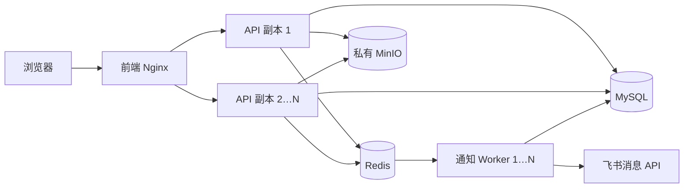

# Redis 平台架构



| 组件 | 职责 | 一致性策略 |
|---|---|---|
| Nginx / Vue | 页面与 API 入口，动态发现 API 副本 | POST 不自动重复提交 |
| API | 登录校验、业务处理、权限校验 | 不设请求频率配额；每次请求读取当前权限 |
| MySQL | 业务、审批、权限、审计、通知发件记录 | 事务、行锁、初始化命名锁；保留为最终记录来源 |
| Redis | 加密的飞书令牌缓存、Streams 通知队列 | 缓存到期释放；队列 ACK 与超时认领 |
| Worker | 消费通知、读取数据库最新收件人权限、调用飞书、补回漏入队通知 | 每 5 秒扫描发件记录，发送失败最多尝试 3 次 |
| MinIO | 附件对象 | 后端授权后访问私有桶 |

## 请求限流已停用

当前 API 入口不再调用 Redis 或数据库限流器，不设置任何 IP、账号或平台总量请求配额；旧 10 秒/20 次及 60 秒/120 次规则不再生效。不再生成频率飞书提醒，历史计数表和通知记录保留。认证、业务权限、操作日志与真实来源 IP 识别继续执行。

旧计数实现保留作兼容工具，不挂接到 HTTP 请求中间件。验收使用同一客户端连续超过 120 次请求，确认不出现平台频率拦截，且不会产生新计数和频率通知。

## 通知与缓存

业务事务提交时保留 `notification_logs`。API 响应后的后台任务只负责把通知 ID 放入 Stream，不等待飞书网络。Redis 不存通知正文或 open_id，Worker 按 ID 从 MySQL 取最新内容，发送前重新检查账号启用状态和安全告警管理员身份。

Worker 消费组支持多个消费者，完成数据库处理后 ACK 并删除消息；工作进程退出后，其他消费者可在 60 秒后认领未确认任务。每 5 秒检查待发送与到期重试记录，覆盖“数据库已提交但入队失败”和 Redis 队列数据丢失。首次失败 30 秒后重试、再次失败 60 秒后重试，最多 3 次；之后保留失败记录供管理员手动重试。

数据库行锁与已发送状态避免并发重复发送，飞书请求使用同一通知的稳定 UUID，降低网络重试造成的重复提醒。网络系统不能保证无限期严格只发送一次；当前采用至少一次消费和业务幂等处理。

升级前的待发送通知保留原内容和状态，`dispatch_ready=0`，不自动集中补发。管理员可在通知记录中手动重试，重试后进入新队列。升级后产生的通知默认启用队列。

飞书租户访问令牌使用 Redis 缓存，在有效期前 60 秒过期；缓存键包含应用凭据的哈希，修改凭据会使用新键。令牌使用现有 Fernet 主密钥加密后存入 Redis。可选缓存故障时可重新向飞书获取令牌。

本次不缓存用户权限、知识库正文、License Key、业务详情或工作台计数，保证撤权、移除成员与业务更新在后续请求立即生效。登录继续使用现有签名令牌，`APP_SECRET`、`FERNET_KEY` 继续由全部副本共享，Redis 不替代加密密钥。

## 部署与运维

```sh
# 已有部署升级：检查凭据、构建、停写备份、更新服务。
bash scripts/update_redis.sh
# 新部署
docker compose up -d --build --wait
# 分别扩容 API 与通知处理进程
docker compose up -d --scale api=3 --scale worker=2 --wait
```

API 数量直接修改 Compose 的 `api.deploy.replicas`；Worker 默认 1 个，可通过上述命令扩容。API 与 Worker 共用后端镜像，更新后端代码时须同时重建对应的 API 和 Worker 容器。Redis 默认无宿主机端口，只允许容器网络访问。当前 Compose 已填写具体密码，不依赖 `.env`；修改 Redis 密码须同步修改 `redis.environment` 和 `api.environment`，Worker 自动继承 API 配置。`REDIS_URL` 和 `REDIS_NAMESPACE` 同样直接填写在 Compose。文件含真实凭据，请按私有部署配置保管。

Redis 默认 256 MB、`noeviction`、AOF 每秒刷盘与持久数据卷，保护待处理通知队列。Redis 容量耗尽时待发送通知保留在 MySQL，Worker 恢复后补发。监控 Redis 内存、延迟、Worker 健康与数据库待发送/失败数量；备份业务数据库、实例主密钥、部署凭据、对象桶以及 Redis 数据卷。不得执行 `docker compose down -v`。

本机部署是单个 Redis 实例，API 多副本不等于全部基础设施高可用。跨主机生产部署可将 `REDIS_URL` 指向受认证保护的托管高可用 Redis / 主从切换代理，API、Worker 和 Redis 应处于受控网络；跨不可信网络使用 `rediss://`。Redis Cluster 的直接客户端发现和 Sentinel 的直连协议当前未接入，使用稳定的 Redis 服务端点。MySQL 与对象存储也需分别配置备份和高可用。

升级只增加通知调度字段和索引，保留旧 `request_rate_limits` 表。回退旧 API 前先停止 Worker；数据库新增字段可保留，数据库、主密钥和对象文件均不需要重建。升级日志为 `reports/redis-update.log`，业务与主密钥备份为 `reports/redis-backups/`。
