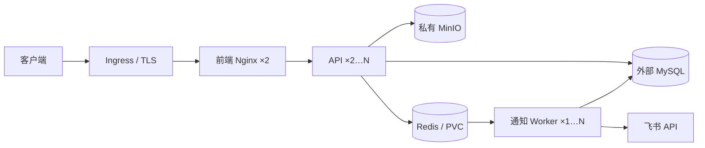

# Kubernetes 部署包 · v1.0.0

先看本文件的安装顺序，再对照 [CONFIGURATION.md](CONFIGURATION.md) 修改配置。此目录提供 K8s 清单，现有 `docker-compose.yml` 保留用于本机开发、数据导出和迁移；K8s 不读取 Compose 的变量或数据卷。

包内没有真实密码、MinIO AK/SK、测试账号或测试单据。`v1.0.0.sql` 是当前 31 张表的完整纯结构安装脚本。

## 文件位置

| 文件 | 用途 |
|---|---|
| `v1.0.0.sql` | MySQL 8.0.13+ 全新安装，建议 8.4；无 INSERT、演示账号和业务数据 |
| `kustomization.yaml` | 统一部署入口；修改镜像仓库、镜像版本 |
| `config.env` | 普通配置：数据库管理模式、Redis、MinIO 地址、可信代理等 |
| `secrets.example.json` | 私密配置的空白模板，复制后填真实值 |
| `scripts/prepare_secrets.py` | 生成权限为 600 的本地 Secret；新装与迁移显式分开 |
| `manifests/` | 前端、API、Worker、Redis、Ingress、网络策略、PDB |
| `frontend-nginx.conf` | K8s 专用 Nginx 模板，恢复 Ingress 传入的真实客户端 IP |
| `optional/mysql.yaml` | 可选单实例 MySQL + PVC；默认清单使用外部 MySQL |
| `scripts/build_schema.py` | 从当前模型重新生成 SQL；支持 `--check` |
| `scripts/validate.py` | 离线检查渲染结果、引用关系、SQL 数据写入和关键生产设置 |
| `CONFIGURATION.md` | 全部关键变量、存储、Ingress 和迁移注意事项 |
| `VALIDATION.md` | 已完成的 SQL、生产启动、非 root 容器与回归验证及适用范围 |

## 服务关系



Redis 保存令牌缓存和通知队列。请求限流与频率告警已停用，不设置 IP、账号或平台总量请求配额。API/Worker 共享同一个 Secret、数据库和 Redis Namespace。

默认 Redis 是带 AOF 和 PVC 的单实例，不等于 Redis 高可用集群。生产已有托管/高可用 Redis 时，按配置说明改连接并移除包内 Redis 资源；MySQL 与 MinIO 的高可用、备份分别由对应基础设施负责。

## 1. 准备镜像

必须从当前源码重新构建，包含本次新增的生产初始化开关；旧镜像可能仍会生成演示数据。

确认 `backend/license-tool/LicenseTool-1.0-SNAPSHOT-jar-with-dependencies.jar` 已放好。JAR、Java、LibreOffice、中文字体随 API 镜像发布，Worker 使用同一 API 镜像。JAR 缺失时 License 生成会提示工具未安装。

在项目根目录执行，替换仓库地址；平台需与 K8s 节点架构一致：

```sh
docker buildx build --platform linux/amd64 -f backend/Dockerfile -t registry.example.com/project-workspace/api:v1.0.0 --push .
docker buildx build --platform linux/amd64 -f frontend/Dockerfile -t registry.example.com/project-workspace/frontend:v1.0.0 --push ./frontend
```

修改 `kustomization.yaml` 中两个 `newName` / `newTag`。私有仓库需要给 API、Worker、前端配置 `imagePullSecrets`；不要把 Docker Desktop 的本地镜像名称当成集群可拉取的仓库地址。

## 2. 选择新装或迁移

### 全新安装

由 DBA 在目标 MySQL 执行：

```sh
mysql --host=数据库地址 --port=3306 --user=有建库权限的账号 --password < k8s-deploy/v1.0.0.sql
```

导入后 31 张表均为空。应用首次启动才会创建你指定的初始管理员，以及必要的角色、空知识空间、流程模板、资源类型和系统配置；不会创建演示用户、项目、文章、申请单或通知。默认流程模板需要登录后配置实际岗位成员并发布。

准备私有输入，编辑数据库连接和 MinIO 凭据：

```sh
mkdir -p k8s-deploy/.private
chmod 700 k8s-deploy/.private
cp k8s-deploy/secrets.example.json k8s-deploy/.private/input.json
chmod 600 k8s-deploy/.private/input.json
# 编辑 input.json，将 REPLACE_ 等占位内容替换为真实配置。
python3 k8s-deploy/scripts/prepare_secrets.py --mode new
```

空白的 Redis 密码、初始管理员密码以及两种主密钥会自动生成。生成结果为 `.private/workspace-secrets.yaml`，请在自己的电脑中查看管理员初始密码，不能公开或提交 Git。也可以在输入中自行指定符合复杂度要求的初始密码。生成器拒绝覆盖已有输出，避免误换密钥。

### 从当前 Docker 平台迁移

迁移使用原数据库备份，保留账号、业务数据和原 `keys.json`，不使用纯结构 SQL 代替业务备份。先停写、备份 MySQL，并将备份恢复到目标数据库；核对 MinIO 对象可访问。历史本地附件必须先迁移到 MinIO，本包的实例目录使用 `emptyDir`，不保留本地附件。

安全导出原主密钥：

```sh
mkdir -p k8s-deploy/.private
chmod 700 k8s-deploy/.private
docker compose cp --index 1 api:/app/instance/keys.json k8s-deploy/.private/keys.json
chmod 600 k8s-deploy/.private/keys.json
cp k8s-deploy/secrets.example.json k8s-deploy/.private/input.json
chmod 600 k8s-deploy/.private/input.json
# 编辑 input.json，填入目标数据库、原私有 MinIO 凭据，以及目标 Redis 密码。
python3 k8s-deploy/scripts/prepare_secrets.py --mode migrate --keys-file k8s-deploy/.private/keys.json
```

迁移模式要求原主密钥，不会生成替代密钥。数据库已有成员时，不创建新管理员，也不重置原密码。迁移后的首次启动按原有增量迁移逻辑补字段；启动前保留数据库备份。

## 3. 修改环境配置和入口

至少检查以下项目，详细说明见 [CONFIGURATION.md](CONFIGURATION.md)：

1. 镜像仓库及节点架构。
2. `DATABASE_URL`、MinIO AK/SK 和 Redis 密码。
3. `TRUSTED_PROXY_CIDRS`、`INGRESS_PROXY_CIDR` 必须对应实际网络；`10.244.0.0/16` 是示例值。
4. Ingress 的域名、`ingressClassName`、TLS Secret；同步修改 `CORS_ORIGINS`。
5. Redis PVC 的 `storageClassName`、容量，以及 NetworkPolicy 中真实 Ingress namespace / Pod 标签。

创建 namespace、Secret 和 TLS 证书：

```sh
kubectl apply -f k8s-deploy/manifests/namespace.yaml
kubectl apply -f k8s-deploy/.private/workspace-secrets.yaml
kubectl -n project-workspace create secret tls workspace-tls --cert=/安全路径/tls.crt --key=/安全路径/tls.key
```

现有证书管理系统也可创建同名 TLS Secret。`workspace.example.com` 需解析到 Ingress 的公网或内网入口，API 和 Redis 不单独公开端口。

## 4. 检查并部署

在项目根目录运行：

```sh
kubectl kustomize k8s-deploy > k8s-deploy/rendered.yaml
python3 k8s-deploy/scripts/validate.py
# 确认镜像、网络、域名、Secret 和存储配置后，向自己的目标集群部署：
kubectl apply -k k8s-deploy
kubectl -n project-workspace rollout status statefulset/workspace-redis --timeout=300s
kubectl -n project-workspace rollout status deployment/workspace-api --timeout=600s
kubectl -n project-workspace rollout status deployment/workspace-worker --timeout=600s
kubectl -n project-workspace rollout status deployment/workspace-reminder-scheduler --timeout=600s
kubectl -n project-workspace rollout status deployment/workspace-frontend --timeout=300s
kubectl -n project-workspace get pods,svc,ingress,pvc
```

离线检查脚本需要 Python 的 PyYAML；可在自己的 Python 虚拟环境执行 `python -m pip install -r k8s-deploy/scripts/requirements-validation.txt` 安装校验依赖。如已安装 `kubernetes-validate==1.31.0`，还会按 K8s 1.31 严格校验标准资源。也可在自己的集群执行 `kubectl apply --dry-run=server -k k8s-deploy` 检查版本与准入策略。实际集群版本、StorageClass 和 Ingress Controller 仍需与本地示例对照确认。

首次登录后，在系统配置保存正式平台名称、访问地址和飞书通知凭据，再配置成员、项目及审批流程。`BOOTSTRAP_ADMIN_PASSWORD` 仅用于空库首次建管理员，后续修改此变量不会重置数据库中的登录密码。

## 5. 验收和后续更新

- 查看 API 日志无密钥不一致、数据库权限或 Redis 认证错误。
- 分别从两个真实客户端 IP 访问，确认 API / Nginx 日志中来源地址不同；同一 IP 连续超过 120 次请求也不因频率被平台拦截。不使用伪造 X-Forwarded-For 代替公网来源日志验收。
- 提交一条实际业务申请，确认通知记录入队、Worker 消费以及申请人与审批人收件正确。
- 上传、下载和预览附件，确认使用私有 MinIO；验证最终审批后的 License 生成。
- 新装环境确认没有演示账号或业务记录；迁移环境核对原账号、文章版本及凭据解密。

更新 `config.env` / Nginx 模板后重新 `kubectl apply -k`，Kustomize 的 ConfigMap 哈希会触发相关 Pod 更新。更新 Secret 后需明确滚动重启 API 和 Worker；若改 Redis 密码，还需同步 Redis，并安排短暂切换窗口。后端代码更新时同时更新 API / Worker 镜像，不要只更新 API。

```sh
kubectl -n project-workspace rollout restart deployment/workspace-api deployment/workspace-worker deployment/workspace-reminder-scheduler
# 临时扩容；长期配置应同时修改对应 Deployment 的 replicas，避免下次 apply 覆盖。
kubectl -n project-workspace scale deployment/workspace-api --replicas=3
kubectl -n project-workspace scale deployment/workspace-worker --replicas=2
```

数据库连接由 Secret / 环境变量管理，页面不再写入某个 Pod 的临时连接文件。主密钥由同一 Secret 下发到所有副本，实例目录可以独立使用 `emptyDir`，不要求共享 RWX 磁盘。数据库、Redis PVC、MinIO 和主密钥必须分别备份。

## 可选：没有外部 MySQL 时

这是单实例参考配置。先准备数据库密码，必须与应用 `DATABASE_URL` 中的账号密码对应：

```sh
kubectl apply -f k8s-deploy/manifests/namespace.yaml
mkdir -p k8s-deploy/.private
chmod 700 k8s-deploy/.private
cp k8s-deploy/optional/mysql.env.example k8s-deploy/.private/mysql.env
chmod 600 k8s-deploy/.private/mysql.env
# 编辑 mysql.env，替换两个密码；检查 optional/mysql.yaml 的 StorageClass。
kubectl -n project-workspace create secret generic workspace-mysql-secrets --from-env-file=k8s-deploy/.private/mysql.env
kubectl apply -f k8s-deploy/optional/mysql.yaml
kubectl -n project-workspace rollout status statefulset/workspace-mysql --timeout=600s
kubectl -n project-workspace exec -i workspace-mysql-0 -- sh -c 'MYSQL_PWD="$MYSQL_ROOT_PASSWORD" exec mysql -u root' < k8s-deploy/v1.0.0.sql
```

应用连接地址为 `workspace-mysql:3306`，数据库 `yunweishenji`，普通账号 `workspace`。把连接串写入私有输入后，再按新装步骤部署应用。不导入演示 SQL，也不要删除数据库 PVC 来重试安装。

## v1.0.1 角色与部门职责

升级已有业务库使用本目录 `v1.0.1.sql`，不要重装 `v1.0.0.sql`。备份原库，暂停 API/Worker 写入，连接原业务库执行升级，更新 API/Worker 与前端镜像后恢复部署。本次没有新增配置变量、挂载或表结构；历史审批版本和待办保持原样。配置方式见 `../docs/roles-v1.0.1.md`。

## v1.0.2 知识库版本升级

本目录 `v1.0.2.sql` 只补充文章并发修订号，可重复执行，不删除正文和历史版本。已有库先备份，再执行升级并更新 API、Worker 和前端镜像；新版 API 启动也可自动补字段。更新后刷新编辑页面，自动保存不增加版本，点击“保存文档”成功后增加一个版本。不需要新增环境变量或挂载。详见 `../docs/wiki-versioning-v1.0.2.md`。

## v1.0.3 到期飞书提醒升级

本目录 `v1.0.3.sql` 增加 License、资源申请的提醒开关，以及提醒计划、按收件人去重投递和资源运维责任人表，可重复执行，保留历史数据。升级时同步更新 API、通知 Worker、前端与 `reminder-scheduler`；新版 API 启动也会自动迁移。
